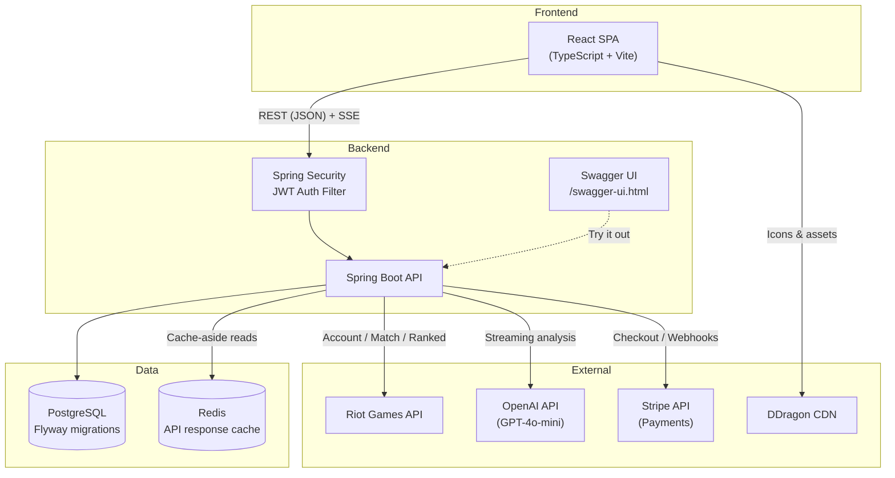

# LoL Tracker

[](https://github.com/jianweicheng0822/lol-tracker/actions/workflows/ci-cd.yml)
[](https://github.com/jianweicheng0822/lol-tracker/actions/workflows/codeql.yml)


[](https://codecov.io/gh/jianweicheng0822/lol-tracker)

Full-stack League of Legends analytics dashboard with AI-powered match coaching. Search any player by Riot ID, explore ranked stats, match history, champion performance, and LP trends — all in a dark-themed UI with real-time AI analysis.

## Demo

**Live Demo:** [https://loltracker.lol](https://loltracker.lol)

> **Note:** The demo runs on an AWS EC2 instance and may be unavailable if the instance is stopped.

## Screenshots

<table>
  <tr>
    <td align="center"><b>Home</b></td>
    <td align="center"><b>Overview</b></td>
  </tr>
  <tr>
    <td></td>
    <td></td>
  </tr>
  <tr>
    <td align="center"><b>Leaderboard</b></td>
    <td align="center"><b>Multi-Search</b></td>
  </tr>
  <tr>
    <td></td>
    <td></td>
  </tr>
  <tr>
    <td align="center"><b>Match History</b></td>
    <td align="center"><b>Login & PRO Upgrade</b></td>
  </tr>
  <tr>
    <td></td>
    <td>
      
      
    </td>
  </tr>
  <tr>
    <td align="center"><b>Champions</b></td>
    <td align="center"><b>Mobile</b></td>
  </tr>
  <tr>
    <td></td>
    <td align="center"></td>
  </tr>
</table>

## Features

**Player Dashboard** — Tabbed profile (Overview, Champions) with URL-driven navigation, ranked badges, win/loss streaks, and persistent favorites. Readable, shareable URLs (`/player/NA/Name/Tag`), a shared header with search and navigation on every page, and layouts that work down to phone width

**Favorites** — Logged-in users see their saved players on the home page as a League-client-style avatar row: profile icon, rank crest, full rank name, and the last 5 ranked games. Removing one can be undone for a few seconds

**Match History** — Match cards with champion icons, KDA, items, runes, and summoner spells. Expandable inline scoreboards with full 10-player stats. Arena mode support with augment icons. Each match has its own shareable page ("Open match page" / "Copy link"). Cross-navigation between player profiles

**Performance Analytics** — LP progression chart with current rank, LP change and peak over the selected range (LP-scaled axis for Master+, division labels below), rolling win rate trend, KDA and damage trends with moving average overlays, per-champion stats grid

**Leaderboard** — Regional leaderboards for Challenger, Grandmaster, and Master tiers. Click any player to jump directly to their profile

**Live Game** — Real-time in-game view for any active player via the Spectator API. Displays champions, ranks, and team compositions for the current match

**Multi-Search** — Batch player lookup. Paste up to 5 Riot IDs, or lines copied straight from the champ select lobby chat, to compare ranked stats side by side. The search lives in the URL, so it can be shared

**AI Match Analysis** — Click the sparkle button on any match to open a chat modal. Streaming responses via SSE for real-time coaching. System prompt constructed server-side from structured match data

**Authentication** — Username/password (BCrypt) or Google/Discord sign-in (OAuth2). Stateless JWT Bearer tokens. Anonymous users have full access to all features except AI coaching and favorites

**Subscription Tiers** — FREE/PRO system via Stripe. All users get full match history and unlimited API access. PRO adds AI match coaching ($4.99/mo via Stripe Checkout)

## Architecture



## Tech Stack

### Backend
| Technology | Purpose |
|------------|---------|
| Java 25 (LTS) / Spring Boot 3.5 | Web framework and REST API (code targets Java 21) |
| Spring Security + JWT | Stateless authentication (jjwt) |
| Spring Data JPA | Database access (repositories) |
| PostgreSQL | Production relational database |
| Redis 7 | Distributed cache for Riot API responses (cache-aside, per-endpoint TTLs) |
| Flyway | Database schema migrations |
| Spring WebFlux | WebClient for OpenAI streaming |
| Stripe Java SDK | Payment processing and subscription management |
| Springdoc OpenAPI | Swagger UI + API documentation |
| Testcontainers | Integration tests with real PostgreSQL |
| JaCoCo | Code coverage enforcement (70% minimum) |

### Frontend
| Technology | Purpose |
|------------|---------|
| React / TypeScript | UI framework with type safety |
| Vite | Dev server and bundler |
| React Router DOM | Client-side routing |
| Recharts | Trend charts |
| Vitest | Unit and component test runner |
| React Testing Library | Component rendering and interaction testing |
| Playwright | End-to-end tests in a real browser (desktop and phone) |

### Infrastructure & DevOps
| Technology | Purpose |
|------------|---------|
| Docker | Multi-stage image (Node 24 build, Maven + Java 25 build, Java 25 JRE runtime, non-root user) |
| GitHub Actions | CI/CD: lint, tests, E2E, build, deploy, post-deploy smoke tests |
| GitHub Container Registry | Image registry |
| AWS EC2 | Single-instance host (app, PostgreSQL, Redis, nginx in Docker) |
| nginx | Reverse proxy, security headers, per-visitor API rate limiting, zero-downtime switchover |
| Cloudflare | TLS, CDN, bot protection |
| CodeQL | Static security analysis of Java, TypeScript and the workflows |
| Dependabot | Weekly dependency updates (npm, Maven, Docker, Actions) |

### External APIs
- **[Riot Games API](https://developer.riotgames.com)** — Account, match, ranked, summoner, and live game (spectator) data
- **[OpenAI API](https://platform.openai.com)** — GPT-4o-mini for AI match analysis
- **[Stripe API](https://stripe.com)** — Checkout sessions, subscription lifecycle, and webhooks
- **[DDragon CDN](https://ddragon.leagueoflegends.com)** — Champion, item, spell, and profile icons
- **[Community Dragon](https://communitydragon.org)** — Ranked tier icons, Arena augment icons

## Quick Start (Docker Compose)

```bash
# 1. Clone and configure
git clone https://github.com/jianweicheng0822/lol-tracker.git
cd lol-tracker
cp .env.example .env   # Edit .env with your API keys

# 2. Start PostgreSQL + Redis + app
docker compose up --build

# 3. Open the app and API docs
#    App:     http://localhost:8080
#    Swagger: http://localhost:8080/swagger-ui.html
```

## Manual Setup

### Prerequisites
- Java 21+ (production and CI use Java 25)
- Node.js 20.19+ (production and CI use Node 24)
- Docker (for the backend integration tests)
- PostgreSQL 16+
- [Riot API Key](https://developer.riotgames.com)
- [OpenAI API Key](https://platform.openai.com/api-keys)

### Environment Variables

Create a `backend/.env` file (or set env vars). The backend uses [spring-dotenv](https://github.com/paulschwarz/spring-dotenv) to load `.env` files automatically. For Docker Compose, the root `.env` file is used instead (see Quick Start above).

| Variable | Required | Default | Description |
|----------|----------|---------|-------------|
| `RIOT_API_KEY` | Yes | — | Riot Games API key |
| `OPENAI_API_KEY` | Yes | — | OpenAI API key for AI analysis |
| `JWT_SECRET` | Yes | — | Secret for signing JWTs (min 32 chars; startup fails if missing or shorter) |
| `REDIS_HOST` | No | `localhost` | Redis host (used for Riot API response caching) |
| `REDIS_PASSWORD` | No | `changeme` | Redis password (must match the Redis server) |
| `DB_HOST` | No | `localhost` | PostgreSQL host |
| `DB_PORT` | No | `5432` | PostgreSQL port |
| `DB_NAME` | No | `lol_tracker` | PostgreSQL database name |
| `DB_USER` | No | `postgres` | PostgreSQL username |
| `DB_PASSWORD` | No | `postgres` | PostgreSQL password |
| `CORS_ORIGIN` | No | `http://localhost:5173` | Allowed CORS origin (single origin; must match where the frontend is served) |
| `APP_BASE_URL` | No | `http://localhost:5173` | Public frontend URL used for Stripe Checkout redirects |
| `STRIPE_SECRET_KEY` | No | — | Stripe secret key (required for PRO subscriptions) |
| `STRIPE_WEBHOOK_SECRET` | No | — | Stripe webhook signing secret |
| `STRIPE_PRICE_ID` | No | — | Stripe Price ID for the PRO plan |
| `GOOGLE_CLIENT_ID` / `GOOGLE_CLIENT_SECRET` | No | — | Google OAuth credentials (required for Google sign-in) |
| `DISCORD_CLIENT_ID` / `DISCORD_CLIENT_SECRET` | No | — | Discord OAuth credentials (required for Discord sign-in) |

> **Windows tip:** variables set globally in your OS environment (e.g. a leftover `DB_PORT` or `DB_PASSWORD` from another project) override both these defaults and `docker compose`'s `${VAR:-default}` fallbacks. If you see `Connection to localhost:<port> refused` or `password authentication failed`, check for conflicting system/user environment variables.

### Running Locally

```bash
# Start PostgreSQL and Redis (via Docker or local install)
docker run -d --name lol-pg -p 5432:5432 \
  -e POSTGRES_DB=lol_tracker -e POSTGRES_PASSWORD=postgres \
  postgres:16-alpine
docker run -d --name lol-redis -p 6379:6379 redis:7-alpine \
  redis-server --requirepass changeme

# Backend — starts at http://localhost:8080
cd backend
./mvnw spring-boot:run

# Frontend — starts at http://localhost:5173 (calls backend directly)
cd frontend
npm install
npm run dev
```

## API Documentation

Interactive Swagger UI is available at `/swagger-ui.html` when the app is running.

### Endpoints

| Domain | Method | Endpoint | Description |
|--------|--------|----------|-------------|
| Auth | POST | `/api/auth/register` | Register new user, returns JWT |
| | POST | `/api/auth/login` | Login, returns JWT |
| OAuth2 | GET | `/api/oauth2/{provider}/authorize` | Start Google/Discord sign-in (sets the state cookie, redirects) |
| | GET | `/api/oauth2/{provider}/callback` | Provider callback; redirects to the app with a JWT |
| | GET | `/api/oauth2/providers` | Which sign-in providers are configured |
| Summoner | GET | `/api/summoner` | Resolve Riot ID to account |
| | GET | `/api/summoner/by-puuid` | Resolve PUUID to account |
| Matches | GET | `/api/matches/recent` | Recent match IDs |
| | GET | `/api/matches/summary` | Match summaries with KDA and rosters |
| | GET | `/api/matches/detail` | Raw match detail from Riot API |
| | GET | `/api/matches/full-detail` | Parsed match detail with all participants |
| Stats | GET | `/api/stats` | Aggregated player statistics |
| Ranked | GET | `/api/ranked` | Ranked entries (Solo/Duo, Flex) |
| Favorites | GET | `/api/favorites` | List all favorites |
| | POST | `/api/favorites` | Add a player to favorites |
| | DELETE | `/api/favorites/{puuid}` | Remove a favorite |
| | GET | `/api/favorites/check/{puuid}` | Check if player is favorited |
| Search History | GET | `/api/search-history` | Recent searches of the logged-in user |
| | POST | `/api/search-history` | Record a search |
| | DELETE | `/api/search-history` | Remove one entry |
| | DELETE | `/api/search-history/all` | Clear history |
| Trends | GET | `/api/trends/champions` | Per-champion aggregated stats |
| | GET | `/api/trends/matches` | Per-match trend data points |
| | GET | `/api/trends/lp` | LP progression history |
| Global | GET | `/api/global/champions` | Global champion pick/win rates |
| | GET | `/api/global/overview` | Global aggregate stats |
| AI | POST | `/api/analyze` | AI match analysis (sync, PRO only) |
| | POST | `/api/analyze/stream` | AI match analysis (SSE streaming, PRO only) |
| Subscription | GET | `/api/tier` | Get current user's subscription tier |
| | GET | `/api/subscription` | Get subscription details |
| | POST | `/api/subscription/cancel` | Cancel subscription at period end |
| Checkout | POST | `/api/checkout/session` | Create Stripe Checkout session |
| | POST | `/api/checkout/portal` | Create Stripe Customer Portal session |
| Leaderboard | GET | `/api/leaderboard` | Regional ranked leaderboard (Challenger/Grandmaster/Master) |
| Live Game | GET | `/api/live-game` | Active game data via Spectator API |
| Multi-Search | POST | `/api/multi-search` | Batch player lookup |
| Webhook | POST | `/api/stripe/webhook` | Stripe webhook handler |
| Health | GET | `/health` | Health check |

## Testing

### Backend

```bash
cd backend

# Unit tests only (MockMvc with mocked services, no Docker needed)
./mvnw test

# Unit + integration tests (requires Docker for Testcontainers)
./mvnw verify
```

| Suite | Count | Database | Docker required |
|-------|-------|----------|-----------------|
| Unit tests | 326 | None (mocked) | No |
| Integration tests | 12 | PostgreSQL (Testcontainers) | Yes |

Unit tests use `@WebMvcTest` with MockMvc and mocked service layers — no database is involved. Integration tests use Testcontainers to spin up a real PostgreSQL container and run Flyway migrations, validating the full stack end-to-end.

### Frontend

```bash
cd frontend

# Run all tests
npm test

# Watch mode for development
npm run test:watch

# Run with coverage report
npm run test:coverage

# End-to-end tests (build first; the tests serve dist/)
npm run build
npx playwright install chromium   # once
npm run test:e2e
```

| Suite | Count | Description |
|-------|-------|-------------|
| Component tests | 230 | MatchList, ScoreboardTable, FavoritesList, PerformanceModal, ProfileHeader, OverviewTab, ChampionsTab, etc. |
| Utility tests | 99 | `playerInsights`, `trends`, LP conversion and chart axes, URL helpers |
| Page and routing tests | 93 | HomePage, PlayerPage, MatchDetailPage, LeaderboardPage, MultiSearchPage, route remounting |
| API module tests | 49 | Token management, login/register, error parsing |
| Hook tests | 21 | `useAuth`, `useBodyScrollLock`, `useIsMobile`, `useTabNavigation`, `useDocumentTitle` |
| **Unit total** | **492** | |
| End-to-end (Playwright) | 20 | 10 scenarios, each on desktop and phone viewports |
| Smoke (Playwright, live site) | 3 | Run against production after every deploy |

Frontend tests use Vitest with jsdom and React Testing Library. Components are tested for rendering, user interaction, form validation, and navigation. API tests mock `fetch` and `localStorage` to verify request construction and token handling.

**End-to-end tests** (`frontend/e2e`) run the production build in Chromium with Playwright. The backend API is served from fixtures and every request outside the app is blocked, so runs are deterministic and never depend on Riot. They cover the main user journeys: search → player page → expand a match → its own page and back, pasting a Riot ID, the not-found card with other regions, switching between players, leaderboard paging kept in the URL, favorites with undo, the 404 page, and no sideways scrolling on phones. They were checked to fail when the feature they cover is broken.

**Smoke tests** (`frontend/smoke`) run against the live site right after each deploy: the backend answers, the home page loads, and a leaderboard player's page shows their matches with real data.

## Security

The backend was reviewed by hand and is scanned by CodeQL on every push (`security-extended` queries, 0 open alerts; false positives are dismissed with a written reason).

- **Authentication:** BCrypt password hashing; HS256 JWTs with a required 32+ byte secret and 24h expiry. Every favorites, search-history and subscription query is scoped to the logged-in user.
- **OAuth2 (Google/Discord):** only verified emails are trusted for account linking; the `state` is single-use, expires after 5 minutes, and is bound to the browser that started the sign-in with an HttpOnly, SameSite=Lax cookie (prevents login CSRF); the pending-state store is capped and cleaned up; the token is handed to the frontend in the URL fragment, so it never reaches server logs.
- **Payments:** PRO is granted only by Stripe webhooks with a verified signature.
- **Rate limiting:** nginx limits the API to 10 requests/second per visitor (bursts of 50), and login/register to 5 attempts a minute, keyed on the real client IP taken from Cloudflare's header and trusted only from Cloudflare's address ranges.
- **Headers:** CSP, HSTS, `X-Frame-Options: DENY`, `nosniff`, and a strict referrer policy. The CSP keeps `'unsafe-inline'` for scripts only because Cloudflare's bot detection injects an inline script; the app itself ships none (see `nginx.conf`).
- **Input handling:** parameterized JPQL only; Riot API URLs built from URI templates; request-derived values have line breaks stripped before logging; generic error bodies.
- **Supply chain:** Dependabot keeps npm, Maven, Docker and Actions dependencies current; third-party Actions are pinned to commit hashes; workflows run with a read-only token by default; `npm audit` reports 0 vulnerabilities.

## Database

PostgreSQL with Flyway-managed migrations:

| Migration | Description |
|-----------|-------------|
| `V1__init_schema.sql` | Initial schema: `app_users`, `favorite_players`, `match_records`, `lp_snapshots` |
| `V2__add_auth_fields.sql` | Adds `username` and `password` columns to `app_users` |
| `V3__add_tracked_players.sql` | Adds `tracked_players` table for background match ingestion |
| `V4__add_user_id_to_favorites.sql` | Links `favorite_players` to `app_users` with foreign key |
| `V5__add_stripe_fields.sql` | Adds Stripe customer ID, subscription ID, and status to `app_users` |
| `V6__add_composite_match_index.sql` | Adds composite index on `match_records` for query performance |
| `V7__add_search_history.sql` | Adds `search_history` table for per-user recent searches |
| `V8__add_oauth_accounts.sql` | Adds `email` to `app_users` and `oauth_accounts` table for Google/Discord login |

Schema is validated at startup (`ddl-auto=validate`) — Flyway is the single source of truth for DDL.

## Production Deployment

### Docker

```bash
docker build -t lol-tracker .

docker run -p 8080:8080 \
  -e RIOT_API_KEY=your-key \
  -e OPENAI_API_KEY=your-key \
  -e JWT_SECRET=your-secret \
  -e DB_HOST=your-db-host \
  -e DB_NAME=lol_tracker \
  -e DB_USER=postgres \
  -e DB_PASSWORD=your-password \
  -e REDIS_HOST=your-redis-host \
  -e STRIPE_SECRET_KEY=your-stripe-key \
  -e STRIPE_WEBHOOK_SECRET=your-webhook-secret \
  -e STRIPE_PRICE_ID=your-price-id \
  lol-tracker
```

### AWS EC2 (CI/CD)

Automated via GitHub Actions (`.github/workflows/ci-cd.yml`). Every pull request and every push to `master` runs:

1. **Frontend:** lint, 492 unit tests, production build, 20 Playwright end-to-end tests
2. **Backend:** 326 unit tests and 12 Testcontainers integration tests (`./mvnw verify`, coverage to Codecov)
3. **CodeQL:** security analysis of Java, TypeScript and the workflows (`.github/workflows/codeql.yml`)

A push to `master` that passes then:

4. **Builds** the Docker image and pushes it to GHCR
5. **Deploys** to EC2 over SSH with **zero downtime** (blue/green, below)
6. **Smoke-tests** the live site with Playwright

#### Zero-downtime deploys

The app runs as one of two containers, `lol-tracker-blue` or `lol-tracker-green`, behind nginx. A deploy:

1. Pulls the new image while the current version keeps serving
2. Starts the new version in the other slot, next to the old one
3. Waits until it answers its health check. **If it never does, it is removed and the old version keeps serving**
4. Validates the new nginx config in a throwaway container, then points nginx at the new version with a graceful `nginx -s reload` (in-flight requests finish on the old one)
5. Stops the old version

The instance has about 1 GB of RAM, so the two JVMs overlap for ~20 seconds on swap; if memory and swap together are ever too tight, the deploy stops the old version first instead. Measured during a deploy: 0 failed requests out of 279, slowest response 0.41 s. Deploys are serialized, so two pushes can't overlap.

Production runs PostgreSQL and Redis as Docker containers on the same instance (managed services like RDS/ElastiCache would work too).

## Project Structure

```
lol-tracker/
├── .github/
│   ├── workflows/ci-cd.yml     # Tests, E2E, build, blue/green deploy, smoke tests
│   ├── workflows/codeql.yml    # CodeQL security scanning
│   └── dependabot.yml          # Weekly dependency updates
├── docker-compose.yml          # Local dev: PostgreSQL + Redis + app
├── .env.example                # Env var template
├── Dockerfile                  # Multi-stage build
├── nginx.conf                  # Production nginx: real client IP, rate limits, security headers
├── backend/
│   ├── src/main/java/com/jw/backend/
│   │   ├── *Controller.java    # REST endpoints (Javadoc on all public methods)
│   │   ├── controller/         # Stripe checkout and webhook controllers
│   │   ├── SpaForwardingController.java  # Forwards non-API routes to React SPA
│   │   ├── security/           # JWT filter, SecurityConfig, JwtUtil
│   │   ├── config/             # OpenApiConfig (Swagger/OpenAPI)
│   │   ├── service/            # Business logic layer
│   │   ├── repository/         # Spring Data JPA interfaces
│   │   ├── entity/             # JPA entities (AppUser, MatchRecord, etc.)
│   │   ├── dto/                # Immutable records for API transport
│   │   ├── region/             # Riot region routing/platform mappings
│   │   └── exception/          # Global exception handler + custom exceptions
│   ├── src/main/resources/
│   │   ├── application.properties
│   │   └── db/migration/       # Flyway SQL migrations
│   └── src/test/
│       ├── java/.../integration/  # Testcontainers integration tests
│       └── resources/             # Test config (Flyway disabled, mocked keys)
└── frontend/
    ├── e2e/                    # Playwright end-to-end tests (mocked API)
    ├── smoke/                  # Playwright smoke tests against the live site
    └── src/
        ├── api.ts              # JWT token management + API client
        ├── types.ts            # Shared TypeScript interfaces
        ├── hooks/              # Custom React hooks (useAuth, useTabNavigation, ...)
        ├── utils/              # DDragon helpers, LP conversion, trend math
        ├── components/         # Reusable UI components (JSDoc documented)
        └── pages/              # Route-level page components
```

## Code Documentation

All source files follow a consistent documentation standard:

- **Backend (Java):** Javadoc with `@file`, `@description`, `@module` headers. All public methods have `@param`, `@returns`, and `@throws` annotations where applicable.
- **Frontend (TypeScript):** JSDoc with the same file header convention. Exported functions and components include parameter and return descriptions.
- **Style:** Imperative mood, concise descriptions focused on intent and business logic rather than restating code.

## License

This project is for educational purposes.

---

Built with the [Riot Games API](https://developer.riotgames.com), [OpenAI API](https://platform.openai.com), and [Stripe](https://stripe.com)
