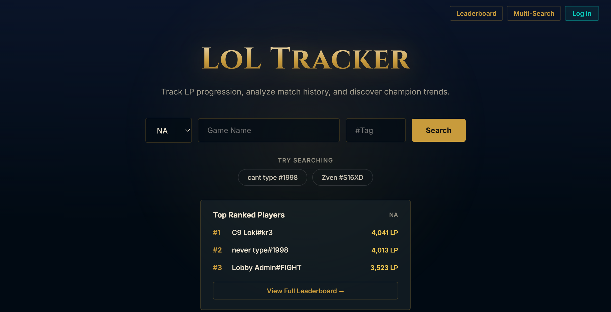
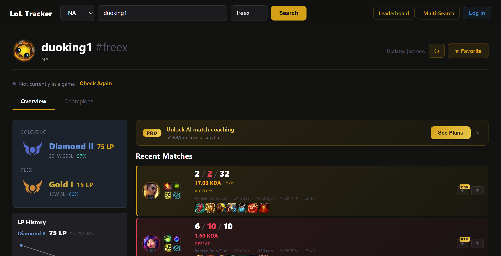
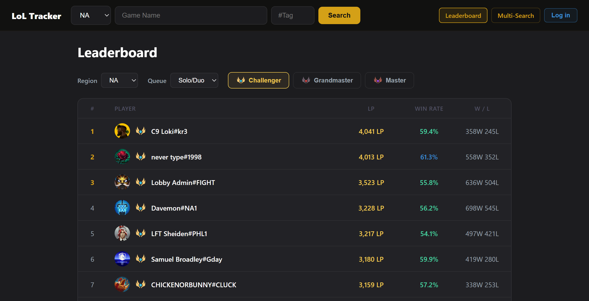
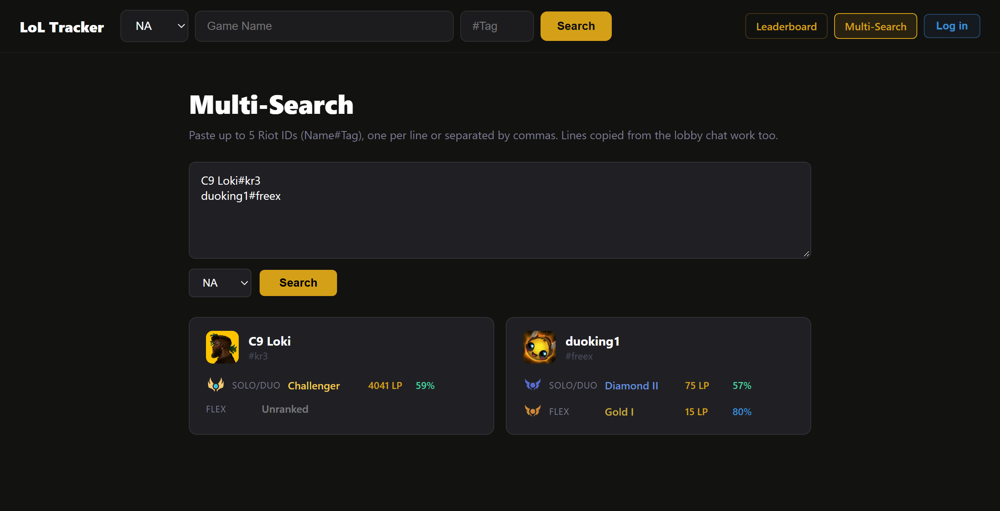
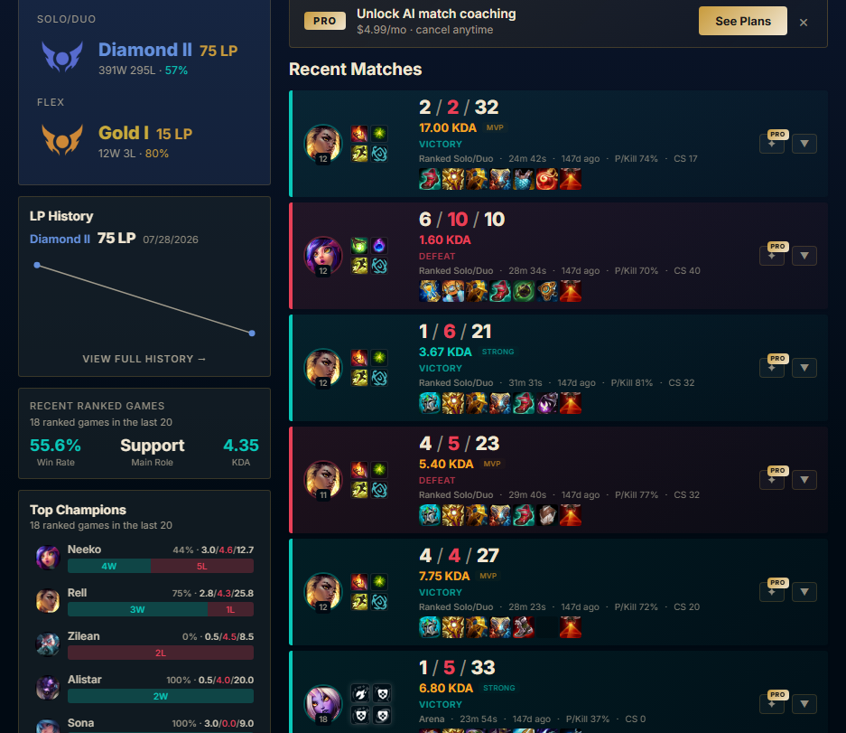
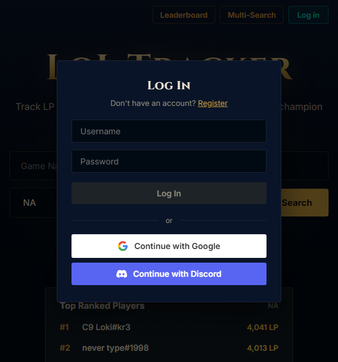
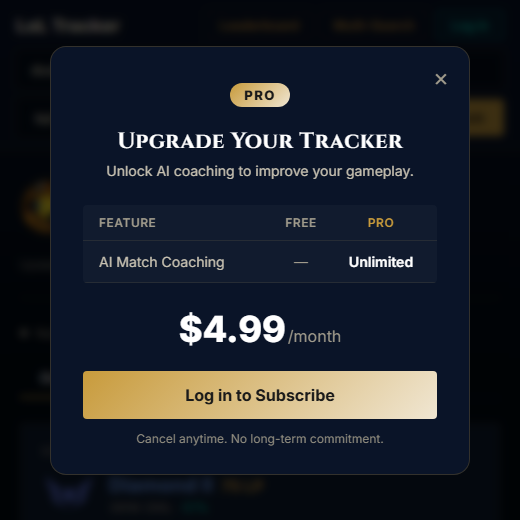
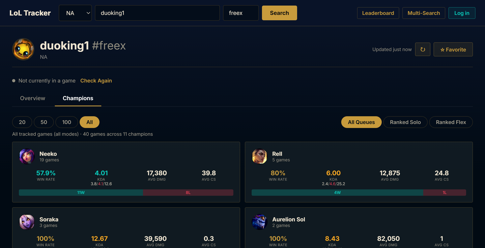
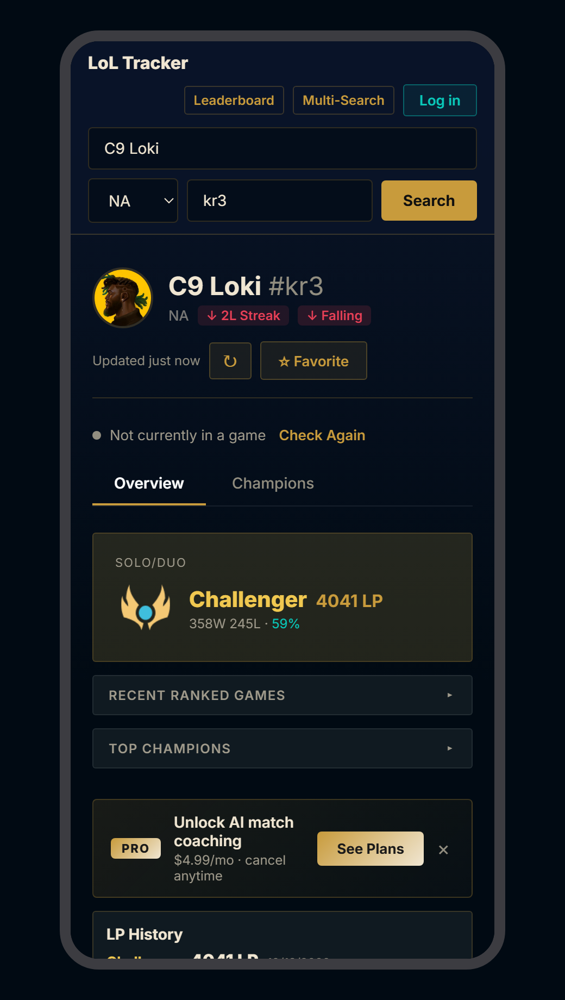
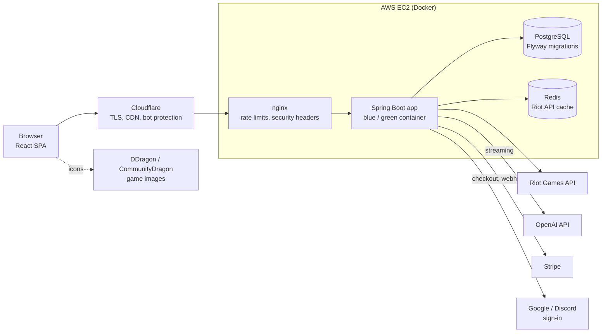

# LoL Tracker

[](https://github.com/jianweicheng0822/lol-tracker/actions/workflows/ci-cd.yml)
[](https://github.com/jianweicheng0822/lol-tracker/actions/workflows/codeql.yml)
[](https://codecov.io/gh/jianweicheng0822/lol-tracker)


A full-stack League of Legends stats site with AI match coaching: search any player by Riot ID for their rank, match history, champion performance and LP over time. Built with Spring Boot, React and PostgreSQL, and run in production on AWS with automated testing, security scanning and zero-downtime deploys.

**Live:** [https://loltracker.lol](https://loltracker.lol)

## Engineering highlights

- **Zero-downtime deploys on a single 1 GB server.** Each release starts next to the running one (blue/green) and nginx switches over only once it's healthy; if it never gets healthy, the old version keeps serving. Measured during a deploy: 0 failed requests out of 279. → [Deployment](#deployment)
- **850 automated tests gate every deploy.** 492 frontend unit tests, 326 backend unit and 12 integration tests (real PostgreSQL via Testcontainers), and 20 Playwright end-to-end runs on desktop and phone. Smoke tests then check the live site after each release. → [Testing](#testing)
- **Security-reviewed.** OAuth sign-in hardened against login CSRF, per-visitor rate limits behind Cloudflare, Stripe webhook signature checks, and CodeQL scanning with 0 open alerts. → [Security](#security)
- **Fast despite a rate-limited data source.** Riot API responses are cached in Redis, leaderboards are prefetched in the background within the API key's limits, and player data is recorded over time to build LP history that Riot doesn't provide.
- **Streaming AI coaching and real payments.** Match analysis streams from OpenAI over Server-Sent Events; PRO subscriptions run through Stripe Checkout and webhooks.

## Screenshots

<table>
  <tr>
    <td align="center"><b>Home</b></td>
    <td align="center"><b>Overview</b></td>
  </tr>
  <tr>
    <td></td>
    <td></td>
  </tr>
  <tr>
    <td align="center"><b>Leaderboard</b></td>
    <td align="center"><b>Multi-Search</b></td>
  </tr>
  <tr>
    <td></td>
    <td></td>
  </tr>
  <tr>
    <td align="center"><b>Match History</b></td>
    <td align="center"><b>Login & PRO Upgrade</b></td>
  </tr>
  <tr>
    <td></td>
    <td>
      
      
    </td>
  </tr>
  <tr>
    <td align="center"><b>Champions</b></td>
    <td align="center"><b>Mobile</b></td>
  </tr>
  <tr>
    <td></td>
    <td align="center"></td>
  </tr>
</table>

> The demo runs on a single AWS EC2 instance and may be unavailable if the instance is stopped.

## Features

**Player Dashboard** — Tabbed profile (Overview, Champions) with ranked badges, win/loss streaks and favorites. Readable, shareable URLs (`/player/NA/Name/Tag`), the same header with search and navigation on every page, and layouts that work down to phone width

**Favorites** — Logged-in users see their saved players on the home page as a League-client-style row: profile icon, rank crest, full rank name and the last 5 ranked games. Removing one can be undone for a few seconds

**Match History** — Match cards with champion icons, KDA, items, runes and summoner spells. Expandable 10-player scoreboards, Arena mode with augment icons, and a shareable page for every match ("Open match page" / "Copy link")

**Performance Analytics** — LP chart with current rank, LP change and peak over the selected range; rolling win rate, KDA and damage trends with moving averages; per-champion stats

**Leaderboard** — Challenger, Grandmaster and Master ladders per region. Click any player to open their profile

**Live Game** — The current match of any player who is in game: champions, ranks and teams (Riot Spectator API)

**Multi-Search** — Look up to 5 players at once, or paste lines straight from the champ select chat, to compare ranks, main champions and recent games. The search is kept in the URL, so it can be shared

**AI Match Analysis** — Click the sparkle button on a match to chat about it. Answers stream in as they're written (Server-Sent Events); the prompt is built on the server from the match data

**Accounts** — Username/password or Google/Discord sign-in. Without an account, everything except AI coaching and favorites is available

**Subscriptions** — FREE and PRO via Stripe. Everything except AI coaching is free; PRO ($4.99/month) adds AI match coaching

## Architecture



The React app is built into the Spring Boot image and served by it, so one container serves both the site and the API. nginx sits in front of it, and Cloudflare in front of nginx.

## Testing

| Suite | Count | Tool | What it covers |
|-------|------:|------|----------------|
| Frontend unit | 492 | Vitest, React Testing Library | Components, pages, hooks, utilities, API client |
| Backend unit | 326 | JUnit, MockMvc, Mockito | Controllers (`@WebMvcTest` with mocked services) and services (Mockito), no database |
| Backend integration | 12 | Testcontainers | Real PostgreSQL with the Flyway migrations: auth, favorites, subscriptions |
| End-to-end | 20 | Playwright | 10 user journeys, each on desktop and phone |
| Smoke | 3 | Playwright | The live site, right after each deploy |

Everything except the smoke tests runs in CI on every pull request and push. Backend line coverage must stay at 70% or more (JaCoCo; currently 74%). The Codecov badge reads a few points lower because it also counts the two Stripe controllers, which the JaCoCo rule leaves out.

**End-to-end tests** (`frontend/e2e`) run the production build in Chromium. The API is served from fixtures and every request outside the app is blocked, so the tests are deterministic and never depend on Riot. They cover:

- search → player page → expand a match → its own page → back
- pasting a full Riot ID (`Name#Tag`) into the search box
- an unknown player, with other regions to try
- switching between players
- leaderboard paging, kept in the URL across a reload
- favorites: remove, then undo
- the 404 page
- no sideways scrolling on the home, player and leaderboard pages

The tests were checked to fail when the feature they cover is broken.

**Smoke tests** (`frontend/smoke`) use real data on the live site: the backend answers, the home page loads, and a leaderboard player's page shows their matches.

<details>
<summary>Frontend unit tests by area</summary>

| Area | Count | Examples |
|------|------:|----------|
| Components | 230 | MatchList, ScoreboardTable, FavoritesList, PerformanceModal, ProfileHeader, OverviewTab, ChampionsTab |
| Utilities | 99 | `playerInsights`, `trends`, LP conversion and chart axes, URL helpers |
| Pages and routing | 93 | HomePage, PlayerPage, MatchDetailPage, LeaderboardPage, MultiSearchPage |
| API client | 49 | Token handling, login/register, error parsing |
| Hooks | 21 | `useAuth`, `useBodyScrollLock`, `useIsMobile`, `useTabNavigation`, `useDocumentTitle` |

</details>

### Running the tests

```bash
# Backend
cd backend
./mvnw test      # unit tests (no Docker needed)
./mvnw verify    # unit + integration tests (needs Docker for Testcontainers)

# Frontend
cd frontend
npm test                          # unit tests
npm run test:coverage             # with a coverage report
npm run build && npm run test:e2e # end-to-end (first time: npx playwright install chromium)
```

## Security

The backend was reviewed by hand, and CodeQL scans the Java, TypeScript and workflow code on every push (extended security queries, **0 open alerts**; false positives are dismissed with a written reason).

| Risk | How it's handled |
|------|------------------|
| Stolen or forged logins | Passwords hashed with BCrypt; JWTs signed with HS256 (32+ byte secret required) and valid for 24 hours |
| Reading or changing another user's data | Every favorites, search-history and subscription query is scoped to the logged-in user |
| Login CSRF through Google/Discord sign-in | The sign-in `state` is single-use, expires after 5 minutes, and must match an HttpOnly, SameSite=Lax cookie set in the browser that started the sign-in |
| Account takeover through OAuth | Only provider-verified emails are used to link accounts |
| Login tokens leaking into logs | After OAuth sign-in the token is passed in the URL fragment (`#token=`), which browsers never send to the server |
| Getting PRO without paying | PRO is granted only by Stripe webhooks with a verified signature |
| Password guessing | The backend allows 5 login or registration attempts per minute per IP |
| Scripts draining the Riot API quota | nginx allows each visitor 10 API requests per second (bursts of 50) |
| Spoofed visitor IPs | The real IP is read from Cloudflare's `CF-Connecting-IP`, and only trusted on requests from Cloudflare's own address ranges |
| Running the server out of memory via sign-in | Pending sign-ins are capped at 10,000 and expired ones are cleared every minute |
| Cross-site scripting, clickjacking | React escapes rendered content; CSP, HSTS, `X-Frame-Options: DENY`, `nosniff` and a strict referrer policy are set by nginx |
| SQL injection, forged log entries | Parameterized JPQL only; line breaks are removed from request values before they're logged |
| Vulnerable or compromised dependencies | Dependabot updates npm, Maven, Docker and Actions weekly; third-party Actions are pinned to commit hashes; workflows get a read-only token by default; `npm audit` reports 0 issues |

One deliberate trade-off: the CSP still allows inline scripts, because Cloudflare's bot detection injects one that changes on every request. The app itself ships no inline scripts, and keeping bot protection was judged worth more (the reasoning is also in `nginx.conf`).

## Deployment

### CI/CD pipeline

GitHub Actions (`.github/workflows/ci-cd.yml`). On every pull request and push to `master`:

1. **Frontend:** lint, unit tests, production build, end-to-end tests
2. **Backend:** unit and integration tests, coverage report to Codecov
3. **CodeQL:** security analysis (`.github/workflows/codeql.yml`)

When a push to `master` passes, it continues:

4. **Build** the Docker image and push it to GitHub Container Registry
5. **Deploy** to EC2 over SSH with zero downtime (below)
6. **Smoke-test** the live site

Deploys run one at a time, so two quick pushes can't overlap.

### Zero-downtime deploys

The app runs as one of two containers, `lol-tracker-blue` or `lol-tracker-green`. A deploy:

1. Pulls the new image while the current version keeps serving
2. Starts the new version in the other slot, next to the current one
3. Waits for it to pass a health check. **If it never does, it's removed and the current version keeps serving**
4. Checks the new nginx config in a throwaway container, then points nginx at the new version with a graceful reload, so requests in progress finish on the old one
5. Stops the old version

The server has about 1 GB of RAM, so the two Java processes overlap for ~20 seconds using swap. If memory and swap together are ever too low for that, the deploy stops the old version first instead (a short outage rather than running out of memory). Measured during a deploy: **0 failed requests out of 279**, slowest response 0.41 s.

PostgreSQL and Redis run as Docker containers on the same instance (managed services such as RDS and ElastiCache would work too).

### Running the image elsewhere

```bash
docker build -t lol-tracker .

docker run -p 8080:8080 \
  -e RIOT_API_KEY=your-key \
  -e OPENAI_API_KEY=your-key \
  -e JWT_SECRET=your-secret \
  -e DB_HOST=your-db-host \
  -e DB_NAME=lol_tracker \
  -e DB_USER=postgres \
  -e DB_PASSWORD=your-password \
  -e REDIS_HOST=your-redis-host \
  -e STRIPE_SECRET_KEY=your-stripe-key \
  -e STRIPE_WEBHOOK_SECRET=your-webhook-secret \
  -e STRIPE_PRICE_ID=your-price-id \
  lol-tracker
```

## Tech Stack

### Backend
| Technology | Purpose |
|------------|---------|
| Java 25 (LTS) / Spring Boot 3.5 | Web framework and REST API (code targets Java 21) |
| Spring Security + JWT | Stateless authentication (jjwt) |
| Spring Data JPA | Database access (repositories) |
| PostgreSQL | Relational database |
| Redis 7 | Cache for Riot API responses (cache-aside, per-endpoint TTLs) |
| Flyway | Database schema migrations |
| Spring WebFlux | WebClient for OpenAI streaming |
| Stripe Java SDK | Payments and subscription management |
| Springdoc OpenAPI | Swagger UI and API documentation |
| Testcontainers | Integration tests with real PostgreSQL |
| JaCoCo | Coverage enforcement (70% minimum) |

### Frontend
| Technology | Purpose |
|------------|---------|
| React / TypeScript | UI framework with type safety |
| Vite | Dev server and bundler |
| React Router | Client-side routing |
| Recharts | Charts |
| Vitest + React Testing Library | Unit and component tests |
| Playwright | End-to-end tests in a real browser (desktop and phone) |

### Infrastructure & DevOps
| Technology | Purpose |
|------------|---------|
| Docker | Multi-stage image (Node 24 build, Maven + Java 25 build, Java 25 JRE runtime, non-root user) |
| GitHub Actions | CI/CD: lint, tests, E2E, build, deploy, smoke tests |
| GitHub Container Registry | Image registry |
| AWS EC2 | Single instance running the app, PostgreSQL, Redis and nginx in Docker |
| nginx | Reverse proxy, security headers, per-visitor rate limits, zero-downtime switchover |
| Cloudflare | TLS, CDN, bot protection |
| CodeQL | Static security analysis |
| Dependabot | Weekly dependency updates |

### External APIs
- **[Riot Games API](https://developer.riotgames.com)** — Account, match, ranked, summoner and live game (spectator) data
- **[OpenAI API](https://platform.openai.com)** — GPT-4o-mini for AI match analysis
- **[Stripe API](https://stripe.com)** — Checkout, subscription lifecycle and webhooks
- **[DDragon CDN](https://ddragon.leagueoflegends.com)** — Champion, item, spell and profile icons
- **[Community Dragon](https://communitydragon.org)** — Ranked tier icons, Arena augment icons

## Running Locally

### Quick start (Docker Compose)

```bash
# 1. Clone and configure
git clone https://github.com/jianweicheng0822/lol-tracker.git
cd lol-tracker
cp .env.example .env   # Edit .env with your API keys

# 2. Start PostgreSQL + Redis + app
docker compose up --build

# 3. Open the app and API docs
#    App:     http://localhost:8080
#    Swagger: http://localhost:8080/swagger-ui.html
```

### Manual setup

**Prerequisites**
- Java 21+ (production and CI use Java 25)
- Node.js 20.19+ (production and CI use Node 24)
- PostgreSQL 16+ and Redis 7 (or run them in Docker, below)
- Docker (for the backend integration tests)
- [Riot API Key](https://developer.riotgames.com) and [OpenAI API Key](https://platform.openai.com/api-keys)

```bash
# Start PostgreSQL and Redis (via Docker or local install)
docker run -d --name lol-pg -p 5432:5432 \
  -e POSTGRES_DB=lol_tracker -e POSTGRES_PASSWORD=postgres \
  postgres:16-alpine
docker run -d --name lol-redis -p 6379:6379 redis:7-alpine \
  redis-server --requirepass changeme

# Backend — starts at http://localhost:8080
cd backend
./mvnw spring-boot:run

# Frontend — starts at http://localhost:5173 (calls backend directly)
cd frontend
npm install
npm run dev
```

### Environment variables

Create a `backend/.env` file (or set env vars). The backend uses [spring-dotenv](https://github.com/paulschwarz/spring-dotenv) to load `.env` files automatically. For Docker Compose, the root `.env` file is used instead.

| Variable | Required | Default | Description |
|----------|----------|---------|-------------|
| `RIOT_API_KEY` | Yes | — | Riot Games API key |
| `OPENAI_API_KEY` | Yes | — | OpenAI API key for AI analysis |
| `JWT_SECRET` | Yes | — | Secret for signing JWTs (min 32 chars; startup fails if missing or shorter) |
| `REDIS_HOST` | No | `localhost` | Redis host (used for Riot API response caching) |
| `REDIS_PASSWORD` | No | `changeme` | Redis password (must match the Redis server) |
| `DB_HOST` | No | `localhost` | PostgreSQL host |
| `DB_PORT` | No | `5432` | PostgreSQL port |
| `DB_NAME` | No | `lol_tracker` | PostgreSQL database name |
| `DB_USER` | No | `postgres` | PostgreSQL username |
| `DB_PASSWORD` | No | `postgres` | PostgreSQL password |
| `CORS_ORIGIN` | No | `http://localhost:5173` | Allowed CORS origin (single origin; must match where the frontend is served) |
| `APP_BASE_URL` | No | `http://localhost:5173` | Public frontend URL used for Stripe Checkout redirects |
| `STRIPE_SECRET_KEY` | No | — | Stripe secret key (required for PRO subscriptions) |
| `STRIPE_WEBHOOK_SECRET` | No | — | Stripe webhook signing secret |
| `STRIPE_PRICE_ID` | No | — | Stripe Price ID for the PRO plan |
| `GOOGLE_CLIENT_ID` / `GOOGLE_CLIENT_SECRET` | No | — | Google OAuth credentials (required for Google sign-in) |
| `DISCORD_CLIENT_ID` / `DISCORD_CLIENT_SECRET` | No | — | Discord OAuth credentials (required for Discord sign-in) |

> **Windows tip:** variables set globally in your OS environment (e.g. a leftover `DB_PORT` or `DB_PASSWORD` from another project) override both these defaults and `docker compose`'s `${VAR:-default}` fallbacks. If you see `Connection to localhost:<port> refused` or `password authentication failed`, check for conflicting system/user environment variables.

## API Reference

Interactive Swagger UI is available at `/swagger-ui.html` when the app is running.

<details>
<summary>All endpoints</summary>

| Domain | Method | Endpoint | Description |
|--------|--------|----------|-------------|
| Auth | POST | `/api/auth/register` | Register new user, returns JWT |
| | POST | `/api/auth/login` | Login, returns JWT |
| OAuth2 | GET | `/api/oauth2/{provider}/authorize` | Start Google/Discord sign-in (sets the state cookie, redirects) |
| | GET | `/api/oauth2/{provider}/callback` | Provider callback; redirects to the app with a JWT |
| | GET | `/api/oauth2/providers` | Which sign-in providers are configured |
| Summoner | GET | `/api/summoner` | Resolve Riot ID to account |
| | GET | `/api/summoner/by-puuid` | Resolve PUUID to account |
| Matches | GET | `/api/matches/recent` | Recent match IDs |
| | GET | `/api/matches/summary` | Match summaries with KDA and rosters |
| | GET | `/api/matches/detail` | Raw match detail from Riot API |
| | GET | `/api/matches/full-detail` | Parsed match detail with all participants |
| Stats | GET | `/api/stats` | Aggregated player statistics |
| Ranked | GET | `/api/ranked` | Ranked entries (Solo/Duo, Flex) |
| Favorites | GET | `/api/favorites` | List all favorites |
| | POST | `/api/favorites` | Add a player to favorites |
| | DELETE | `/api/favorites/{puuid}` | Remove a favorite |
| | GET | `/api/favorites/check/{puuid}` | Check if player is favorited |
| Search History | GET | `/api/search-history` | Recent searches of the logged-in user |
| | POST | `/api/search-history` | Record a search |
| | DELETE | `/api/search-history` | Remove one entry |
| | DELETE | `/api/search-history/all` | Clear history |
| Trends | GET | `/api/trends/champions` | Per-champion aggregated stats |
| | GET | `/api/trends/matches` | Per-match trend data points |
| | GET | `/api/trends/lp` | LP progression history |
| Global | GET | `/api/global/champions` | Global champion pick/win rates |
| | GET | `/api/global/overview` | Global aggregate stats |
| AI | POST | `/api/analyze` | AI match analysis (sync, PRO only) |
| | POST | `/api/analyze/stream` | AI match analysis (SSE streaming, PRO only) |
| Subscription | GET | `/api/tier` | Get current user's subscription tier |
| | GET | `/api/subscription` | Get subscription details |
| | POST | `/api/subscription/cancel` | Cancel subscription at period end |
| Checkout | POST | `/api/checkout/session` | Create Stripe Checkout session |
| | POST | `/api/checkout/portal` | Create Stripe Customer Portal session |
| Leaderboard | GET | `/api/leaderboard` | Regional ranked leaderboard (Challenger/Grandmaster/Master) |
| Live Game | GET | `/api/live-game` | Active game data via Spectator API |
| Multi-Search | POST | `/api/multi-search` | Batch player lookup |
| Webhook | POST | `/api/stripe/webhook` | Stripe webhook handler |
| Health | GET | `/health` | Health check |

</details>

## Database

PostgreSQL with Flyway-managed migrations. The schema is validated at startup (`ddl-auto=validate`), so Flyway is the single source of truth for DDL.

<details>
<summary>Migrations</summary>

| Migration | Description |
|-----------|-------------|
| `V1__init_schema.sql` | Initial schema: `app_users`, `favorite_players`, `match_records`, `lp_snapshots` |
| `V2__add_auth_fields.sql` | Adds `username` and `password` columns to `app_users` |
| `V3__add_tracked_players.sql` | Adds `tracked_players` table for background match ingestion |
| `V4__add_user_id_to_favorites.sql` | Links `favorite_players` to `app_users` with foreign key |
| `V5__add_stripe_fields.sql` | Adds Stripe customer ID, subscription ID, and status to `app_users` |
| `V6__add_composite_match_index.sql` | Adds composite index on `match_records` for query performance |
| `V7__add_search_history.sql` | Adds `search_history` table for per-user recent searches |
| `V8__add_oauth_accounts.sql` | Adds `email` to `app_users` and `oauth_accounts` table for Google/Discord login |

</details>

## Project Structure

```
lol-tracker/
├── .github/
│   ├── workflows/ci-cd.yml     # Tests, E2E, build, blue/green deploy, smoke tests
│   ├── workflows/codeql.yml    # CodeQL security scanning
│   └── dependabot.yml          # Weekly dependency updates
├── docker-compose.yml          # Local dev: PostgreSQL + Redis + app
├── .env.example                # Env var template
├── Dockerfile                  # Multi-stage build
├── nginx.conf                  # Production nginx: real client IP, rate limits, security headers
├── backend/
│   ├── src/main/java/com/jw/backend/
│   │   ├── *Controller.java    # REST endpoints (Javadoc on all public methods)
│   │   ├── controller/         # Stripe checkout and webhook controllers
│   │   ├── SpaForwardingController.java  # Forwards non-API routes to React SPA
│   │   ├── security/           # JWT filter, SecurityConfig, JwtUtil
│   │   ├── config/             # OpenApiConfig (Swagger/OpenAPI)
│   │   ├── service/            # Business logic layer
│   │   ├── repository/         # Spring Data JPA interfaces
│   │   ├── entity/             # JPA entities (AppUser, MatchRecord, etc.)
│   │   ├── dto/                # Immutable records for API transport
│   │   ├── region/             # Riot region routing/platform mappings
│   │   ├── util/               # LogSanitizer
│   │   └── exception/          # Global exception handler + custom exceptions
│   ├── src/main/resources/
│   │   ├── application.properties
│   │   └── db/migration/       # Flyway SQL migrations
│   └── src/test/
│       ├── java/.../integration/  # Testcontainers integration tests
│       └── resources/             # Test config (Flyway disabled, mocked keys)
└── frontend/
    ├── e2e/                    # Playwright end-to-end tests (mocked API)
    ├── smoke/                  # Playwright smoke tests against the live site
    └── src/
        ├── api.ts              # JWT token management + API client
        ├── types.ts            # Shared TypeScript interfaces
        ├── hooks/              # Custom React hooks (useAuth, useTabNavigation, ...)
        ├── utils/              # DDragon helpers, LP conversion, trend math
        ├── components/         # Reusable UI components (JSDoc documented)
        └── pages/              # Route-level page components
```

## Code Documentation

All source files follow a consistent documentation standard:

- **Backend (Java):** Javadoc with `@file`, `@description`, `@module` headers. All public methods have `@param`, `@returns`, and `@throws` annotations where applicable.
- **Frontend (TypeScript):** JSDoc with the same file header convention. Exported functions and components include parameter and return descriptions.
- **Style:** Imperative mood, concise descriptions focused on intent and business logic rather than restating code.

## License

This project is for educational purposes.

---

Built with the [Riot Games API](https://developer.riotgames.com), [OpenAI API](https://platform.openai.com), and [Stripe](https://stripe.com)
